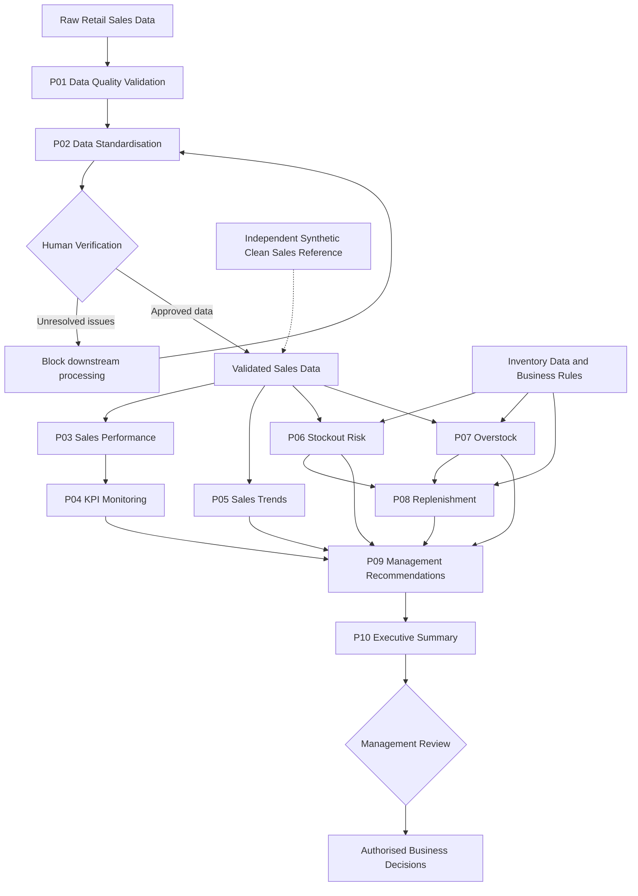

# AI-Powered Retail Sales & Inventory Management

### BUS4005 — AI for Business
### Assessment 1: AI Prompt Library and Consultancy Pitch
### La Trobe University

---

## 1. Project Overview

This project presents an AI prompt library designed
to support weekly sales analysis, inventory management
and managerial decision-making for a hypothetical
medium-sized Australian fashion retailer.

The proposed solution consists of ten structured
business prompts organised into four interconnected
workflow stages.

The objective is to demonstrate how generative AI
can support repetitive analytical tasks while
maintaining data integrity, evidence traceability
and human decision authority.

This project is a manually tested prototype,
not a deployed production system.

## 2. Business Problem

Retail businesses frequently encounter challenges
associated with:

- Inconsistent sales and inventory records.
- Time-consuming manual data validation.
- Fragmented performance reporting.
- Stock shortages and excess inventory.
- Inconsistent replenishment decisions.
- Information overload for senior management.

These challenges may delay operational decisions
and increase inventory-related business risks.

The proposed AI-assisted workflow addresses these
issues through structured prompts, explicit
business rules and human verification.

## 3. Proposed AI Solution

The prompt library supports four business stages:

1. Data Preparation
2. Sales Performance Analysis
3. Inventory Management
4. Management Decision Support

Each prompt performs a defined business task
and produces structured information that can
support subsequent workflow stages.

The prototype uses manually coordinated prompt
chaining rather than automated system integration.

## 4. Prompt Library

| ID | Prompt | Business Function |
|---|---|---|
| P01 | [Data Quality Validation](prompts/P01-data-quality-validation.md) | Identify data errors |
| P02 | [Retail Data Standardisation](prompts/P02-data-standardisation.md) | Control data corrections |
| P03 | [Sales Performance Analysis](prompts/P03-sales-performance.md) | Analyse product and category performance |
| P04 | [KPI Performance Monitoring](prompts/P04-kpi-monitoring.md) | Evaluate business targets |
| P05 | [Sales Trend Identification](prompts/P05-sales-trends.md) | Identify product sales changes |
| P06 | [Stockout Risk Detection](prompts/P06-stockout-risk.md) | Identify inventory shortages |
| P07 | [Overstock Identification](prompts/P07-overstock-identification.md) | Identify excess inventory |
| P08 | [Replenishment Recommendations](prompts/P08-replenishment-recommendations.md) | Calculate replenishment and escalate policy conflicts |
| P09 | [Business Action Recommendations](prompts/P09-business-recommendations.md) | Support management decisions |
| P10 | [Executive Summary Report](prompts/P10-executive-summary.md) | Communicate key findings to senior management |

## 5. Business Workflow

The independent Clean Sales reference dataset
was used to test downstream analytical prompts
because unresolved data corrections in P02
required human approval.

It was not treated as an automatically approved
output from P02.

## 6. Prompt Engineering Methodology

Each prompt was developed through an iterative
design and testing process.

Version 1.0 established an initial business
instruction.

Version 1.1 introduced improvements based on
observed limitations in the initial output.

The prompt engineering techniques include:

- RACE Framework
- Role-based prompting
- Structured output requirements
- Explicit business rules and formulas
- Input validation
- Exception handling
- Multi-input prompt chaining
- Cross-source consistency checking
- Evidence traceability
- Human-in-the-loop decision controls

## 7. Testing and Evaluation

The ten prompts were tested using ChatGPT
and a synthetic retail business dataset.

Each initial prompt was compared with an
improved version using equivalent task inputs.

The evaluation framework assesses five criteria:

| Criterion | Description |
|---|---|
| Faithfulness | Consistency with supplied information |
| Completeness | Coverage of required business information |
| Format Compliance | Adherence to specified output requirements |
| Business Usability | Practical usefulness for the intended business task |
| Risk Control | Handling of uncertainty, exceptions and decision authority |

Each criterion is scored from 1 to 5,
giving a maximum score of 25 per prompt version.

Detailed testing observations and iteration
audit logs are available in the evaluations folder.

## 8. Evaluation Results

| Prompt | Initial v1.0 | Revised v1.1 |
|---|---:|---:|
| P01 | 19/25 | 24/25 |
| P02 | 16/25 | 24/25 |
| P03 | 20/25 | 24/25 |
| P04 | 20/25 | 24/25 |
| P05 | 21/25 | 24/25 |
| P06 | 19/25 | 23/25 |
| P07 | 19/25 | 23/25 |
| P08 | 19/25 | 23/25 |
| P09 | 21/25 | 24/25 |
| P10 | 21/25 | 24/25 |
| Total | 195/250 | 237/250 |

Initial evaluation score: 78.0%

Revised evaluation score: 94.8%

Improvement: 16.8 percentage points.

These scores represent qualitative prototype
evaluations rather than independently measured
production performance.

Some evaluations remain provisional pending
independent source-data verification and
additional exception testing.

## 9. Key Business Findings

The synthetic business scenario produced
the following analytical findings:

| Business Metric | Reported Result |
|---|---:|
| Latest weekly gross revenue | AUD 12,320 |
| Hypothetical revenue target | AUD 14,000 |
| Revenue target achievement | 88% |
| Revenue shortfall | AUD 1,680 |
| Stockout-risk products | 4 |
| Calculated stock shortfall | 255 units |
| Overstocked products | 3 |
| Excess inventory | 78 units |
| Calculated replenishment | 960 units |
| Pending standard approval | 913 units |
| Requiring policy decisions | 47 units |
| Authorised replenishment | 0 units |

These findings illustrate the functionality of
the proposed prototype.

They are not actual commercial results from
a real retail organisation.

## 10. Responsible AI and Human Governance

The proposed workflow incorporates:

- Human verification of data corrections.
- Explicit handling of missing information.
- Transparent calculation methods.
- Escalation of conflicting business rules.
- Preservation of original calculation results.
- Separation of recommendations and approvals.
- Management approval before purchasing decisions.

For example, P08 identified two products that
were classified as overstocked while generating
positive replenishment quantities.

The revised prompt preserved the calculated
quantities and escalated the conflicts instead
of independently overriding business policies.

Prompt-based controls guide AI behaviour but
do not constitute enforceable technical access
controls or production security mechanisms.

## 11. Dataset and Tools

The retail dataset is synthetic and was
generated with generative AI for educational
and prototype testing purposes.

It contains hypothetical sales transactions,
inventory records, business rules and KPI
reference information.

No real customer records or confidential
commercial data were used.

Tools used:

- ChatGPT
- Microsoft Excel
- Visual Studio Code
- Git
- GitHub

## 12. Project Limitations

- Testing is based on a limited synthetic scenario.
- Generative AI may produce inconsistent outputs.
- Upstream errors may propagate between prompts.
- Some source-data verification remains outstanding.
- Additional exception and adversarial testing is required.
- No live retail system integration was implemented.
- No automatic purchasing system was implemented.
- Actual time savings and financial benefits were not measured.
- Human verification and management approval remain necessary.

## 13. Repository Structure

    Retail-Ai-Promt-Library/
    |
    |-- data/
    |-- prompts/
    |-- evaluations/
    |-- workflows/
    |-- README.md

## 14. Conclusion

This project demonstrates how a structured AI
prompt library can support retail business
analysis and management decision-making.

Iterative prompt engineering improved output
structure, calculation transparency, evidence
traceability and decision authority controls
within the tested synthetic scenario.

The proposed solution positions generative AI
as a decision-support tool rather than a
replacement for human business judgement.

## 15. AI Usage Disclosure

Generative AI was used to support synthetic
dataset generation, prompt development,
iterative testing, output evaluation and
project documentation.

The outputs are intended for educational
purposes and require critical human review.

---

Developed for BUS4005 — AI for Business
at La Trobe University.
## 16. Supporting Documentation

- [Workflow Documentation](workflows/retail-ai-workflow.md)
- [Evaluation Summary](evaluations/evaluation-summary.md)
- [Exception and Adversarial Testing](evaluations/exception-testing.md)

Four selected additional exception tests were
completed successfully, covering embedded
instructions, missing information, threshold
boundaries and conflicting upstream inputs.

These findings are limited to the tested
synthetic scenarios and do not establish
production readiness.
